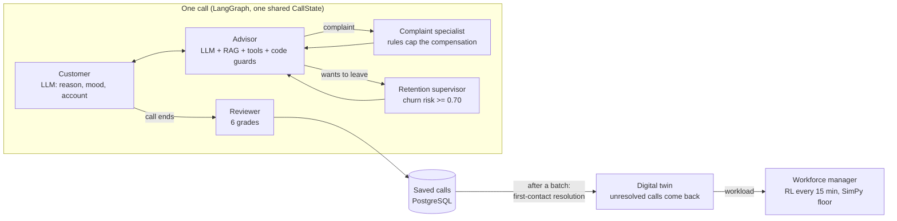

# CallVerse

[](https://github.com/nourjihenelabed/callverse/actions/workflows/tests.yml)

CallVerse is a **digital twin of a telecom call center**. AI customers call AI advisors about real customer
accounts; specialised agents handle complaints and customers who want to leave; every call is graded; and a
reinforcement-learning floor manager decides how many advisors to staff. The **digital twin** connects the two:
the quality of the AI calls becomes workload for the floor, so a better advisor agent has a price in euros.

It is a school project. Everything runs on a laptop: llama3.1 8B on Ollama, PostgreSQL, Chroma, LangGraph, SimPy.

## How it fits together



| Agent | Decides with | Code |
|---|---|---|
| Customer | LLM, with a call reason, a mood and its real account (IBM Telco, 7,043 customers) | `callverse/agents/client/` |
| Advisor | LLM + rules search (RAG) + database tools; every answer is checked by code guards | `callverse/agents/advisor/` |
| Complaint specialist | LLM classifies and drafts; code rules cap the compensation and decide the escalation | `callverse/agents/complaint/` |
| Retention supervisor | Code only, from the churn model (logistic regression, AUC 0.853) | `callverse/agents/retention/` |
| Reviewer | LLM for relevance, accuracy, empathy; code for compliance and resolution | `callverse/agents/quality/` |
| Digital twin | Measures first-contact resolution and turns repeat calls into workload | `workforce/twin.py` |
| Workforce manager | PPO agent correcting the Erlang C plan, on a SimPy floor calibrated on 444,448 real calls | `workforce/` |

The agents never call each other: a LangGraph graph passes one case file (`callverse/state.py`) from agent to
agent, and plain code decides who works next (`callverse/graph.py`). Where money, escalation or a loyalty offer
is at stake, code rules decide and the LLM only explains.

## Results at a glance

| What | Result | Where |
|---|---|---|
| Churn model | AUC 0.853 on held-out customers, against 0.784 for the rule it replaced | `scripts/explain_churn.py` |
| Calls, night-1 → night-2 | resolved 52% → 62%, quality 3.87 → 4.07; only empathy is significant (p = 0.05) with 50 calls | `evaluation/compare.md` |
| Workforce manager | 7,003 €/day on average against 8,357 € for Erlang C (−16%), smallest worst case of the 4 policies | `workforce/README.md` |
| Digital twin (night-2) | 68% helped at the first contact → +16% calls; ignoring them drops the service level to 77%, planning for them brings it back to 88.6% | `python -m workforce.twin` |
| RL on the twin's workload | the bank-trained agent, not told about the repeat calls, still reaches 90.8% (7,672 €/day against 10,008 € for the plan that ignores them); retrained on the twin: 93.5%, 1.4% hang-ups, 6,971 €/day | `python -m workforce.train --twin` |
| Calls, night-2 → night-3 | after three changes (retention-offer guard, outage credit rule, rules search by intent): quality 4.07 → 3.74 and empathy 3.96 → 3.46, both significant. Ablation night-3b, the same code with the intent search off: resolution is still down (62% → 40%), so the search is not the cause. The losses gather on complaints and customers leaving, where the two stricter rules apply. Night-3 and night-3b differ only by the search, yet resolution moves by 10 points: with 50 calls, that is the size of chance | `scripts/compare_runs.py` |
| Calls, night-3 → night-5 | after reading the failed calls (`scripts/export_calls.py`), three targeted fixes: escalate when a customer refuses the decision and tell them their recourse, give the ticket reference, no loyalty offer on top of an escalated complaint. Empathy 3.46 → 3.82 (p = 0.05) and quality without the outcome 4.21 → 4.40 (p = 0.04), both significant; complaints handled 2/10 → 6/10, customers leaving handled 30% → 50%. Against night-2, no difference is significant (resolved 62% → 44%, p = 0.07): more calls end escalated instead of resolved, and the drop sits on dissatisfied customers asking for routine requests, not on the routes we changed | `evaluation/compare_night3_night5.md` |
| AI reviewer | too generous: kappa near 0 except accuracy (0.42) against a second grader, so its grades compare batches, not absolute quality | `evaluation/` |

## CallVerse Studio

The whole system in one web page, for a demo:

```bash
python studio/server.py        # opens http://127.0.0.1:8600
```

The tabs follow the story of the project, from one call to the staffing:

1. **Live floor**: place a call (customer, reason, mood) and watch it. Each agent lights up while it works, the
   conversation appears line by line and the case file fills in. At the end, the studio says what the call means
   for the twin (helped at the first contact, or a likely repeat call).
2. **Scenarios**: pick one of five scenarios (an invoice question, an outage, a third billing complaint, a
   customer at high churn risk who wants to leave, an offer question). Before it runs, the page shows the route
   the code should take; during a real call, each agent becomes a step with its file and function, every function
   that runs inside it (what it read in PostgreSQL or the rules index, what the LLM or the rules decided), what it
   wrote into the case file, and why `graph.py` sent the call to the next agent (`studio/walkthrough.py`).
3. **Agents**: what each agent does, how it decides, and a button to try it live.
4. **Call history**: replay any saved call with its decisions and grades.
5. **Results**: the KPIs of a batch, including first-contact resolution, and the reviewer's agreement check.
6. **Digital twin**: the pipeline from the batch's quality to the floor's workload, with the callback assumption
   and a what-if for a better advisor as sliders, and the same 20 days simulated in each situation.
7. **Workforce**: one simulated day with the four floor managers on the same calls, replayed every 15 minutes,
   with the bank workload or with the twin's workload (the AI calls' repeat calls).

A strip at the top of the last three tabs carries the same numbers from one step to the next. The web server uses
only the Python standard library.

## What is in this repository

| Folder or file | What it holds |
|---|---|
| `callverse/state.py` | The case file that travels through a call |
| `callverse/graph.py` | The LangGraph graph: which agent works next |
| `callverse/agents/` | One folder per agent, each with its README |
| `callverse/knowledge.py` | The rules search (RAG over `data/policies/`) |
| `callverse/churn.py` | The churn model |
| `callverse/results.py` | Saved calls and their summaries |
| `workforce/` | The SimPy floor, the floor managers, the RL agent, the evaluation and the digital twin |
| `studio/` | CallVerse Studio, the demo web app |
| `dashboard/` | The Streamlit scoreboard and the one-page HTML report |
| `data/policies/` | The company rules of the fictional operator |
| `scripts/` | Data preparation, batches of calls and evaluation |
| `evaluation/` | Tables for the report: batch comparison, reviewer agreement |
| `tests/` | The test suite (no AI model, database or data needed); run on every push by GitHub Actions |
| `settings.yaml`, `.env.example` | Shared settings, and a model for your own `.env` |

## How we work together

1. Never change `main` directly. `main` is the official version and it must always work.
2. For each task, make your own branch from `main`. Name it `worker/task`, for example `complaint/classify`.
3. Mostly change files in your own folder.
4. When your task works, open a pull request. One teammate checks it.
5. Click "Squash and merge", then delete the branch.
6. Start your next task from a fresh `main`.
7. Ask the team before changing `state.py`, `llm.py`, `graph.py`, or `knowledge.py`, because everyone depends on them.

## Everyday commands

Start a new task:

```bash
git checkout main
git pull
git checkout -b complaint/classify
```

Save your work:

```bash
git add .
git commit -m "say what you changed"
```

Send your work to GitHub:

```bash
git push -u origin complaint/classify
```

After your pull request is merged:

```bash
git checkout main
git pull
git branch -D complaint/classify
```

Get your teammates' latest work while you are still on your branch:

```bash
git pull origin main
```

## Setting up on your computer

### 1. The database

We store customers, complaints, and tickets in PostgreSQL.

1. Install PostgreSQL from postgresql.org/download. Remember the password you choose during the install.
2. Open "SQL Shell (psql)", log in with that password, and type: `CREATE DATABASE callverse;`
3. In the project folder, copy `.env.example` to a new file named `.env`.
4. In `.env`, replace `YOUR_PASSWORD` with your PostgreSQL password.

Never put your `.env` file on GitHub. It is already blocked, so `git add .` will skip it.

### 2. Python and the project

1. Install Python 3.11 or newer from python.org.
2. In the project folder, create and turn on your own Python space:

   ```bash
   python -m venv .venv
   source .venv/bin/activate        # Windows: .venv\Scripts\Activate.ps1
   ```

   On Windows, if `python` is blocked or points to another program, use `py -m venv .venv` instead.
3. Install the project and its packages:

   ```bash
   pip install -e ".[dev]"
   ```

4. Check that a full pretend call works:

   ```bash
   pytest
   ```

   This needs no AI model and no database. Run it before every pull request.

### 3. The AI model

1. Install Ollama from ollama.com/download. It needs about 15 GB of free disk space with the models.
2. Download the model the team picked (written in `settings.yaml`), for example `ollama pull <model>`.
3. If your computer is too small, a teammate can run Ollama for you: put their address in your `.env` as `OLLAMA_BASE_URL`.

### 4. The company rules search

1. Install Chroma: `pip install -e ".[dev,rag]"`. If Windows blocks it, set `rag: store: "local"` in your own copy of `settings.yaml` (don't push that change) and skip this step.
2. With Ollama running, build the index: `python scripts/build_index.py "Combien coûte la Box Fibre ?"`
3. Build it again whenever a file in `data/policies/` changes.

### 5. Try the advisor

With Ollama running, the database filled and the rules indexed:

```bash
python scripts/try_advisor.py                  # 4 prepared questions
python scripts/try_advisor.py --chat           # type your own messages
```

It shows what the advisor understood, the tools it used and its answer. See `callverse/agents/advisor/README.md`.

### 6. Run whole pretend calls

The AI customer talks to the AI advisor from start to finish:

```bash
python scripts/try_call.py                                         # 3 random calls
python scripts/try_call.py --reason complaint_billing --persona demanding
```

After each call the reviewer's grades are printed, with the reason for each (`--short` hides the reasons).
See `callverse/agents/client/README.md` and `callverse/agents/quality/README.md`. Complaint calls open real tickets: run `python scripts/seed_data.py` again to clean them.

### 7. The scoreboard

Run a batch of calls (saved in the database), then look at the results:

```bash
python scripts/run_calls.py --calls 50 --run night-1    # 1 to 2 hours; run it again to continue
pip install -e ".[dashboard]"
streamlit run dashboard/app.py                          # or: python scripts/build_report.py (one HTML page)
```

See `dashboard/README.md`.

### 7b. CallVerse Studio

```bash
python studio/server.py        # opens http://127.0.0.1:8600
```

See "CallVerse Studio" at the top of this page.

### 8. Close the loop (phase 3)

After a batch of calls, see what the conversations change for the staffing:

```bash
python -m workforce.twin --run night-2           # measures the batch, compares 4 situations, saves twin.json
python -m workforce.train --twin                 # optional: an RL agent trained on the twin's floor (~20 min)
python -m workforce.twin --run night-2           # again: adds the two RL agents to the comparison
```

See "Phase 3" in `workforce/README.md`. The studio's Digital twin tab shows the same pipeline live.

### 9. Evaluation

```bash
python scripts/compare_runs.py night-1 night-2 --markdown evaluation/compare.md   # two batches, with significance tests
$env:CALLVERSE_INTENT_SEARCH="0"; python scripts/run_calls.py --calls 50 --run night-3b   # ablation: intent search off (PowerShell)
python scripts/judge_agreement.py export --run night-2 --calls 10                # grade 10 calls yourself...
python scripts/judge_agreement.py compare                                        # ...and compare with the AI reviewer
python scripts/explain_churn.py                                                  # the churn model's test results
```

The tables are written in `evaluation/`, ready for the report.
